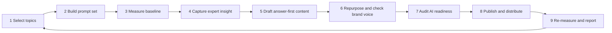

# SEO and GEO AI Marketing Kit

Step-by-step workflow for B2B marketers who want their expertise to be found, cited and trusted in AI-generated answers. It turns an expert's insight into answer-first content, repurposes it in the brand voice, audits it for AI readiness and measures the effect with a fixed prompt set.

The kit contains guides, prompt templates, checklists, CSV templates and a small Python script that calculates visibility metrics from a logged set of AI answers.

## Who it is for

- Product marketing, brand marketing and demand generation teams
- Content and communication teams that work with subject matter experts
- Marketers who need to show before and after evidence for their work

## What GEO means here

GEO (Generative Engine Optimization) is the practice of making content easy for AI answer engines to find, understand and cite. It does not replace SEO. SEO asks whether a search engine can find and rank a page. GEO asks whether an AI engine mentions or recommends the brand when it answers a buyer's question.

## The workflow



| Step | What happens | Guide |
|---|---|---|
| 1 | Score and choose the topics that matter most | [docs/01-select-topics.md](docs/01-select-topics.md) |
| 2 | Write a fixed, versioned set of buyer prompts | [docs/02-build-the-prompt-set.md](docs/02-build-the-prompt-set.md) |
| 3 | Log AI answers and calculate the baseline | [docs/03-measure-the-baseline.md](docs/03-measure-the-baseline.md) |
| 4 | Interview an expert and build a claims register | [docs/04-capture-expert-insight.md](docs/04-capture-expert-insight.md) |
| 5 | Draft an article that gives the answer first | [docs/05-draft-answer-first-content.md](docs/05-draft-answer-first-content.md) |
| 6 | Create social, newsletter and video formats and check the voice | [docs/06-repurpose-and-check-brand-voice.md](docs/06-repurpose-and-check-brand-voice.md) |
| 7 | Check access, relevance and extraction on each page | [docs/07-audit-ai-readiness.md](docs/07-audit-ai-readiness.md) |
| 8 | Publish, share with partners and build outside signals | [docs/08-publish-and-distribute.md](docs/08-publish-and-distribute.md) |
| 9 | Run the same prompts again, compare and plan the next loop | [docs/09-remeasure-and-report.md](docs/09-remeasure-and-report.md) |

Metric definitions and limits are in [docs/measurement-guide.md](docs/measurement-guide.md). Ideas for automating parts of the workflow are in [docs/automation-ideas.md](docs/automation-ideas.md).

## Where AI helps and where a person decides

| Task | AI | Person |
|---|---|---|
| Suggest topics and prompt variations | Yes | Decides and scores |
| Transcribe interviews and extract claims | Yes | Expert confirms every claim |
| Draft articles from confirmed facts | Yes | Editor and expert approve |
| Adapt content into formats | Yes | Content owner approves |
| Check the brand voice | Flags problems | Final approval |
| Audit page content | Yes | Web team fixes technical items |
| Judge sentiment in answers | Not used | Person logs and reviews |
| Write the results summary | Drafts | Checks every number |

## Repository contents

```text
docs/         one guide per step, the measurement guide and automation notes
prompts/      six prompt templates, one for each AI-assisted task
templates/    CSV and Markdown templates for topics, prompts, answer logs,
              claims, checklists, interviews, brand voice and reports
scripts/      geo_metrics.py, the metrics calculator
sample-data/  synthetic answer logs and the script that generated them
```

## Quick start

1. Copy `templates/topic-scorecard.csv` and score your topics (step 1).
2. Write your prompts in `templates/prompt-set.csv` (step 2).
3. Run each prompt on each engine and log the answers in `templates/ai-answer-log.csv` (step 3).
4. Calculate the baseline.

```bash
python scripts/geo_metrics.py --log my-baseline.csv --brand YourBrand --domains yourbrand.com
```

5. Follow steps 4 to 8 to create and publish content.
6. After four to six weeks, log a second run and compare.

```bash
python scripts/geo_metrics.py --log my-baseline.csv --compare my-followup.csv \
    --brand YourBrand --domains yourbrand.com --by engine
```

The script uses only the Python standard library and needs Python 3.8 or newer.

## Example output

The command below uses the synthetic sample data included in the repository.

```bash
python scripts/geo_metrics.py --log sample-data/ai-answer-log-baseline.csv \
    --compare sample-data/ai-answer-log-followup.csv \
    --brand BrightGrid --domains brightgrid.example
```

| Group | Metric | Baseline | Follow-up | Change (points) |
|---|---|---|---|---|
| All answers | Answer inclusion rate | 21.7% | 50.0% | +28.3 |
| All answers | Share of Voice | 15.9% | 28.8% | +13.0 |
| All answers | Share of Citation | 5.0% | 6.5% | +1.5 |
| All answers | Positive sentiment | 53.8% | 56.7% | +2.8 |

These figures come from random synthetic data. They show the format of the output and are not evidence that the method produces any particular result.

## Limits

- AI answers vary between runs, users and engines, so results are indicative.
- A change in visibility can have causes other than your content.
- The kit measures visibility in AI answers and does not measure sales.
- Always check AI-written content against confirmed facts before publication.

## Author

Mansi Panchal, B2B digital marketer. [LinkedIn](https://www.linkedin.com/in/mansip5)

## License

MIT. See [LICENSE](LICENSE).
